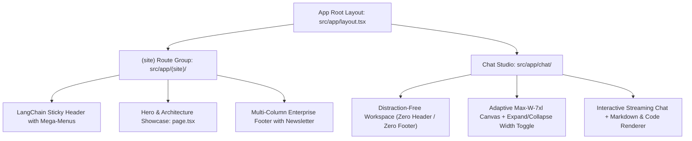

<div align="center">

# 🦜🔗 LangChain Studio AI

<p align="center">
  <strong>Next-Generation AI Platform & Interactive Developer Studio inspired by LangChain</strong>
</p>

<p align="center">
  <a href="https://nextjs.org"></a>
  <a href="https://react.dev"></a>
  <a href="https://tailwindcss.com"></a>
  <a href="https://www.typescriptlang.org"></a>
  <a href="#"></a>
  <a href="#"></a>
</p>

<p align="center">
  <a href="#01-architecture--route-isolation">Architecture</a> •
  <a href="#02-core-features--changelog">Features</a> •
  <a href="#03-theme--design-tokens">Theme Tokens</a> •
  <a href="#04-project-structure">Directory Map</a> •
  <a href="#05-quick-start">Quick Start</a> •
  <a href="#06-release-checklist">Checklist</a>
</p>

</div>

---

> [!NOTE]
> **Design Philosophy**: Built with the signature **LangChain Emerald & Obsidian Slate** design language (`#0B0F17` background, `#10B981` accents, and crisp glassmorphism). Engineered with strict route-group isolation to maintain a distraction-free studio workflow.

---

### `01` Architecture & Route Isolation
<p>Clean architectural separation between the public marketing portal and the dedicated developer workspace.</p>



<table>
<tr>
<td width="50%" valign="top">

#### 🌐 Marketing Portal (`/`)
* **Header**: Glassmorphism navbar, live announcement banner, animated product dropdowns (LangChain, LangGraph, LangSmith), and mobile hamburger drawer.
* **Footer**: Enterprise 4-column directory, newsletter subscription form, dynamic system status ping, and brand socials.
* **Hero Section**: High-conversion hero showcasing 350M+ downloads, agent runtime stats, and one-click CTA to Studio.

</td>
<td width="50%" valign="top">

#### ⚡ Chat Studio (`/chat`)
* **No Header & No Footer**: Standalone full-viewport canvas (`h-dvh`) designed purely for reading and coding without marketing distraction.
* **Optimized Reading Width**: Upgraded from narrow `max-w-3xl` (768px) to **`max-w-5xl / 7xl`** so multi-column code, roadmaps, and tables are effortlessly readable.
* **Canvas Toggle**: Integrated top-bar toggle (`Maximize2` / `Minimize2`) to switch instantly between Standard & Edge-to-Edge reading modes.

</td>
</tr>
</table>

---

### `02` Core Features & Changelog
<p>Summary of new features, UX improvements, and stability fixes.</p>

<table>
  <thead>
    <tr>
      <th width="15%">Category</th>
      <th width="35%">Feature / Change</th>
      <th width="50%">Impact & Details</th>
    </tr>
  </thead>
  <tbody>
    <tr>
      <td><code>✨ Added</code></td>
      <td><strong>Dedicated <code>/chat</code> Route</strong></td>
      <td>Independent workspace layout completely omitting marketing Header and Footer for maximum IDE immersion.</td>
    </tr>
    <tr>
      <td><code>✨ Added</code></td>
      <td><strong>LangChain Mega Dropdowns</strong></td>
      <td>Interactive menus for Products, Learn, Company, and Docs with smooth backdrop blur and transition effects.</td>
    </tr>
    <tr>
      <td><code>✨ Added</code></td>
      <td><strong>Expand / Standard Width Toggle</strong></td>
      <td>One-click canvas width switcher allowing users to toggle between standard readable width and widescreen studio view.</td>
    </tr>
    <tr>
      <td><code>⚡ Changed</code></td>
      <td><strong>Enhanced Chat Readability</strong></td>
      <td>Removed excessive empty margins on left/right by expanding container to <code>max-w-7xl</code> with <code>text-[15px] sm:text-base</code> typography.</td>
    </tr>
    <tr>
      <td><code>⚡ Changed</code></td>
      <td><strong>Responsive Navigation Scaling</strong></td>
      <td>Scaled up undersized button and typography sizes across header and footer to match modern UI guidelines.</td>
    </tr>
    <tr>
      <td><code>🛠️ Fixed</code></td>
      <td><strong>SSR Hydration Mismatch</strong></td>
      <td>Resolved server/client mismatch by introducing mounted guards and eliminating non-deterministic SSR DOM trees.</td>
    </tr>
    <tr>
      <td><code>🛠️ Fixed</code></td>
      <td><strong>Duplicate Action Buttons</strong></td>
      <td>Consolidated redundant buttons on tablet and laptop screens (1024px–1280px) into a responsive drawer.</td>
    </tr>
  </tbody>
</table>

---

### `03` Theme & Design Tokens
<p>Precision-calibrated dark theme inspired by LangChain's enterprise design system.</p>

| Token Name | Hex Code | Visual Sample | Usage |
| :--- | :---: | :---: | :--- |
| **Obsidian Dark** | `#0B0F17` |  `Deep Canvas` | Root page background, studio base, and card backdrops |
| **Elevated Surface** | `#111827` |  `Surface Slate` | Assistant response card, dropdown popovers, and inputs |
| **LangChain Emerald** | `#10B981` |  `Primary Emerald` | Primary CTAs, active badges, status indicators, and hover states |
| **Emerald Highlight** | `#34D399` |  `Glow Accent` | Link hover states, glow borders, and code highlighting |
| **Border Muted** | `rgba(255,255,255,0.08)` |  `Glass Border` | Glassmorphic cards, dividers, and input outlines |
| **Text Primary** | `#FFFFFF` |  `Crisp White` | Headings, hero copy, and primary navigation items |
| **Text Muted** | `#9CA3AF` |  `Cool Gray` | Descriptions, timestamps, and secondary captions |

---

### `04` Project Directory Map
<p>Clean structure powered by Next.js App Router route groups.</p>

```
ai-fe-repo/
├── src/
│   ├── app/
│   │   ├── (site)/                    # Marketing Site Route Group (Header + Footer)
│   │   │   ├── layout.tsx             # Wraps children with <Header /> & <Footer />
│   │   │   └── page.tsx               # LangChain Hero, Pillars & Feature Showcase
│   │   ├── chat/                      # Dedicated Standalone Workspace
│   │   │   └── page.tsx               # Full-screen Chat Studio (NO Header / NO Footer)
│   │   ├── favicon.ico                # App favicon
│   │   ├── globals.css                # Tailwind CSS v4 directives & theme styles
│   │   └── layout.tsx                 # Clean Root Layout (HTML + Body only)
│   ├── components/
│   │   ├── chat/
│   │   │   ├── CodeBlock.tsx          # Syntax highlighter with Copy button & Emerald badge
│   │   │   └── MarkdownRenderer.tsx   # Markdown parser for formatted AI responses
│   │   ├── icons/
│   │   │   └── BrandIcons.tsx         # Custom GitHub, X, LinkedIn, YouTube SVGs
│   │   ├── Footer.tsx                 # LangChain-styled responsive footer + newsletter
│   │   └── Header.tsx                 # LangChain-styled sticky navbar + announcement
│   └── services/
│       └── ai.service.ts              # API client for backend communication (/ai/chat)
├── public/                            # Static SVG and image assets
├── package.json                       # Dependencies & scripts
├── tsconfig.json                      # Strict TypeScript configuration
└── README.md                          # Project documentation
```

---

### `05` Quick Start & Configuration
<p>Follow these steps to run the application locally.</p>

#### 1. Clone & Install Dependencies
```bash
# Clone the repository
git clone https://github.com/your-username/ai-fe-repo.git

# Navigate to project directory
cd ai-fe-repo

# Install dependencies using npm
npm install
```

#### 2. Configure Environment Variables
Create a `.env.local` file in the root directory:
```env
# URL of your AI backend service
NEXT_PUBLIC_API_URL=http://localhost:5000/api/v1
```

#### 3. Start Development Server
```bash
npm run dev
```
Open **[http://localhost:3000](http://localhost:3000)** in your browser to view the application:
* 🌐 **Landing Page:** [http://localhost:3000/](http://localhost:3000/)
* ⚡ **Chat Studio:** [http://localhost:3000/chat](http://localhost:3000/chat)

#### 4. Build for Production
```bash
# Optimized Next.js production build with Turbopack
npm run build

# Start production server
npm run start
```

---

### `06` Release Checklist
<p>Production verification milestones for current and upcoming releases.</p>

- [x] **Next.js 16.4 Turbopack compilation passing with exit code 0**
- [x] **Zero SSR hydration mismatch errors on client render**
- [x] **Isolated `/chat` workspace without website Header and Footer**
- [x] **Home page (`/`) featuring full LangChain Header and Footer**
- [x] **Chat reading width expanded to `max-w-7xl` with full-width toggle**
- [x] **Responsive mobile drawer navigation for small/tablet viewports**
- [x] **Syntax highlighted code blocks with one-click copy feedback**
- [ ] *Optional*: Multi-session history sidebar persistence via LocalStorage / Database
- [ ] *Optional*: Streaming token response support via Server-Sent Events (SSE)

---

<div align="center">
  <sub>Built with ❤️ inspired by <a href="https://www.langchain.com/">LangChain</a>. Designed for high performance and developer immersion.</sub>
</div>
